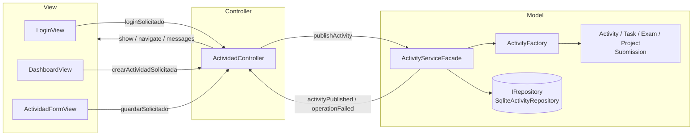

# Design and Architecture: MVC using Qt

## Overview

`managmentApp` is a Qt 6 Widgets application (C++20) that demonstrates how to design a
desktop application using the **Model–View–Controller (MVC)** pattern. The sample domain
is academic activity management ("Seguimiento Académico"): a teacher logs in, sees a
dashboard of courses, and creates activities (tasks, exams, projects) that are persisted
in SQLite and assigned to students.

The main architectural goal is a strict separation of responsibilities:

- **Views** only display data and emit high-level UI signals. They do not know the model.
- **The Model** owns domain rules and persistence. It does not know the views.
- **The Controller** connects both worlds: it translates view data into model data,
  coordinates navigation, and forwards model results back to the UI.

Qt's **signals and slots** are the communication mechanism used between all three layers.

## Architecture at a glance



`main.cpp` acts as the **composition root**: it creates the database, repository,
facade, views and controller, injects the dependencies, connects everything and starts
the Qt event loop.

## Layers

### Model (`models/`)

The model contains the domain entities, the persistence abstraction and an application
service facade:

| File | Responsibility |
| --- | --- |
| `activity.h/.cpp` | Abstract `QObject` base entity; defines `Activity::Type` (`Task`, `Exam`, `Project`) and common behavior (`isValid()`, `isOverdue()`, `canSubmit()`, `toVariantMap()`). |
| `task.h/.cpp`, `exam.h/.cpp`, `project.h/.cpp` | Concrete activities with polymorphic validation and serialization (late submission, duration in minutes, delivery format and team members). |
| `submission.h/.cpp` | Student submission entity with `Pending`, `Submitted`, `Graded` states. |
| `IRepository.h` | Persistence interface — keeps the domain decoupled from SQLite. |
| `sqliteactivityrepository.h/.cpp` | SQLite implementation: creates the schema, saves activities and their pending submissions. |
| `activityfactory.h/.cpp` | **Factory Method** that builds the right `Activity` subtype from a `QVariantMap` (coming from the view) or from a SQL record. |
| `activityservicefacade.h/.cpp` | **Facade**: single entry point (`publishActivity()`). Creates, validates, persists, assigns students and emits results via `activityPublished()` / `operationFailed()`. |

Because the model is expressed as interfaces and signals, it can be tested or reused
without any widget code.

### View (`views/`)

The view layer is made of Qt Designer forms (`login.ui`, `dashboard.ui`,
`actividad_form.ui`) and their C++ wrapper classes:

| Class | Signals emitted |
| --- | --- |
| `LoginView` | `loginSolicitado()` |
| `DashboardView` | `crearActividadSolicitada(TipoVista)`, `cursoSeleccionado()` |
| `ActividadFormView` | `guardarSolicitado(const ActividadFormData&)`, `cancelarSolicitado()` |

`viewtypes.h` defines UI-only types (`TipoVista` and the `ActividadFormData` DTO).
This is intentional: views never include model headers, so UI types are translated by
the controller instead of leaking domain types into the widgets. AUTOUIC (enabled via
`qt_standard_project_setup`) generates the `ui_*.h` files at build time.

### Controller (`controllers/`)

`ActividadController` is the only controller. It receives the facade and all three
views by pointer (dependency injection) and:

- handles view signals: `onLoginSolicitado()`, `onCrearActividadSolicitada()`,
  `onGuardarSolicitado()`, `onCancelarSolicitado()`;
- maps `TipoVista` → `Activity::Type` and `ActividadFormData` → `QVariantMap`;
- supplies courses/students (`setCursos()`, `setEstudiantes()`);
- manages navigation (login → dashboard → activity form);
- handles model responses (`onActividadPublicada()`, `onOperacionFallida()`) by showing
  status/error messages.

## Request flow

1. The user fills the activity form and presses *Guardar*.
2. `ActividadFormView` emits `guardarSolicitado(ActividadFormData)`.
3. `ActividadController::onGuardarSolicitado()` converts the DTO into a `QVariantMap`
   and calls `ActivityServiceFacade::publishActivity()`.
4. The facade uses `ActivityFactory` to create the concrete activity, validates it,
   saves it through `IRepository` (SQLite) and creates pending submissions for the
   enrolled students.
5. The facade emits `activityPublished()` or `operationFailed()`.
6. The controller receives the signal and updates the UI (message + navigation).

## Design patterns used

- **MVC** — separation of presentation, application logic and domain/persistence.
- **Repository** — `IRepository` abstracts data access; SQLite is one implementation.
- **Facade** — `ActivityServiceFacade` gives the controller one simple API for a
  multi-step operation.
- **Factory Method** — `ActivityFactory` creates polymorphic activity subtypes.
- **DTO** — `ActividadFormData` carries data across the view/controller boundary.
- **Dependency injection / composition root** — object creation and wiring happen in
  `main.cpp`.

## Features

- Login screen (stub: any non-empty credentials are accepted).
- Dashboard with a list of courses and buttons to create a *Tarea*, *Examen* or *Proyecto*.
- Activity form with title, course, due date, Markdown notes, resource links, file
  attachment and type-specific fields.
- Domain validation rules for each activity type.
- SQLite persistence in `QStandardPaths::AppDataLocation/seguimiento.db`.
- Automatic creation of pending submissions for enrolled students (or only team members
  for projects).

## Build and run

Requirements: CMake ≥ 3.16, C++20, and Qt 6.8+ with the `Widgets` and `Sql` modules.

```bash
cmake -S . -B build -DCMAKE_BUILD_TYPE=Debug
cmake --build build
./build/appmanagmentApp
```

The Qt Creator kit in this repository uses Ninja and the build directory
`build/Desktop_Debug`:

```bash
cmake --build build/Desktop_Debug
./build/Desktop_Debug/appmanagmentApp
```

The application needs write access to the Qt `AppDataLocation` folder in order to create
`seguimiento.db`.

## Project structure

```text
.
├── CMakeLists.txt
├── main.cpp                 # composition root
├── models/                  # domain entities, repository, factory, facade
├── views/                   # .ui forms and QWidget classes
├── controllers/             # ActividadController
└── importedcontent/         # place for imported Figma/Qt designs
```

PlantUML class diagrams for each layer are available in `models/salida.puml`,
`views/salida.puml` and `controllers/salida.puml`.

## Known limitations

- Authentication is a placeholder; there is no user model yet.
- Courses and student CUIs are hardcoded in `main.cpp`.
- `DashboardView::cursoSeleccionado()` and `ActivityServiceFacade::loadCourseActivities()`
  are implemented but not wired into the UI yet.
- The `importedcontent/` directory is not added to the build with `add_subdirectory()`.
